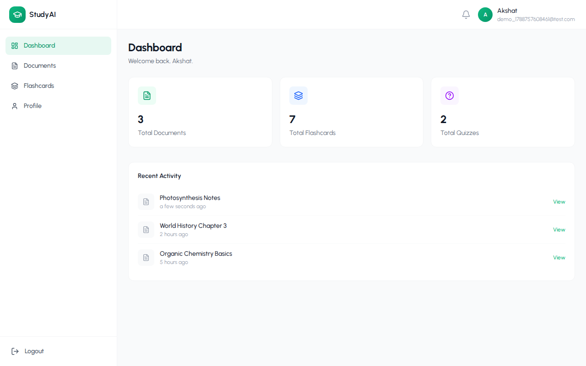

# AI-Powered Learning Assistant

Upload a PDF, then chat with it, summarise it, and turn it into flashcards and quizzes. Built with React, Express, MongoDB and OpenAI.

**[Live demo](https://ai-learning-assistant-alpha-wine.vercel.app)** · Click **Try the demo** on the login page, no sign-up needed. The API runs on Render's free tier, so the first request can take 30–50 seconds to wake up.



## Features

| | |
|---|---|
| **Documents** | Upload a PDF (10 MB). Text is extracted automatically, with OCR for scanned files. Read it in the app, including on phones. |
| **Chat** | Ask questions and get streamed answers that cite the exact page. Click a citation to jump to it in the PDF. |
| **Summaries** | One-click summary or concept explanation. |
| **Flashcards** | AI-generated decks with spaced-repetition review (FSRS) and a daily due queue. Export to CSV or Anki. |
| **Quizzes** | AI-generated multiple choice, graded on the server. Retake any quiz, or export it as Markdown. |
| **Weak spots** | The dashboard ranks the concepts you miss most and can generate practice cards for them. |
| **Your data** | Rename or delete documents, download everything as JSON, delete your account. |

Also: bring-your-own OpenAI key, a read-only demo account, a Ctrl/⌘+K command palette, and secure auth (rotating refresh tokens, CSRF protection, session list).

## Tech stack

- **Frontend:** React 19, Vite, React Router, Tailwind CSS 4
- **Backend:** Node.js, Express 5, MongoDB (Mongoose)
- **AI:** OpenAI API, behind one small wrapper in `backend/utils/aiClient.js`
- **Other:** pdf-parse and tesseract.js for text and OCR, argon2 for passwords, Playwright for end-to-end tests

## Run it locally

You need Node.js 22.12+, a MongoDB database (local or [Atlas](https://www.mongodb.com/atlas)), and optionally an [OpenAI API key](https://platform.openai.com/api-keys).

**Backend**

```bash
cd backend
npm install
cp .env.example .env   # then fill in the values below
npm run dev            # http://localhost:8000
```

```env
MONGO_URI=<your MongoDB connection string>
JWT_SECRET=<a long random string>
CLIENT_URL=http://localhost:5173
OPENAI_API_KEY=<optional, see below>
```

Without `OPENAI_API_KEY`, AI features work only for users who save their own key on the Profile page. Every other option is in [`backend/.env.example`](backend/.env.example).

**Frontend**

```bash
cd frontend/ai-learning-assistant
npm install
cp .env.example .env   # sets VITE_API_BASE_URL=http://localhost:8000
npm run dev            # http://localhost:5173
```

Open the app, register, and upload a PDF.

## Tests

| Command | Covers |
|---|---|
| `cd backend && npm test` | API unit and integration tests |
| `cd frontend/ai-learning-assistant && npm test` | Component and unit tests |
| `cd e2e && npm run test:full` | Full user journeys in a real browser, using a fake OpenAI server |
| `cd e2e && npm run eval:check` | Retrieval and citation quality on a 100-question set |

CI runs all of these plus a dependency audit and CodeQL on every push.

## Deployment

The live demo uses **Vercel** for the frontend and **Render** for the API.

1. **API:** Create a Render Blueprint from this repo ([`render.yaml`](render.yaml)). It prompts you for the secrets. Docker is also supported: `docker-compose.yml` runs the whole stack.
2. **Frontend:** Deploy `frontend/ai-learning-assistant` to Vercel or Netlify with `VITE_API_BASE_URL` set to your API URL.
3. **Point them at each other:** Set `CLIENT_URL` on the API to the frontend URL.

Things to know:

- **Cross-domain cookies:** If the frontend and API are on different domains (such as `*.vercel.app` and `*.onrender.com`), set `COOKIE_SAME_SITE=none`. Otherwise users get logged out after 15 minutes. The Render blueprint already sets it.
- **Who pays for AI:** Users can save their own OpenAI key on the Profile page. If you also set `OPENAI_API_KEY`, it acts as a fallback for everyone else. Cap it with `MONTHLY_AI_BUDGET_USD` and set a hard limit in your OpenAI dashboard.
- **Demo account:** Set `DEMO_MODE=true` to enable the "Try the demo" button. The account is read-only and can't spend your key.
- **Uploaded PDFs live on local disk.** Most hosts wipe it on redeploy. Documents then show "file no longer available", but chat, flashcards and quizzes keep working because the text is stored in MongoDB. Use S3 or R2, or a persistent disk via `UPLOAD_DIR`, to keep the files.
- **Health checks:** `GET /health` for liveness, `GET /ready` for readiness. `GET /metrics` serves Prometheus metrics (set `METRICS_TOKEN`).
- **Admins:** Set `ADMIN_EMAILS` to unlock the cost dashboard at `/admin/costs`.

## More docs

- [FSRS vs. SM-2 scheduler comparison](docs/scheduler-comparison.md)
- [RAG evaluation](e2e/evals/README.md)
- [Roadmap](ROADMAP.md)

## Project layout

```
backend/                       Express API (controllers, models, routes, utils)
frontend/ai-learning-assistant React app (pages, components, services)
e2e/                           Playwright tests and RAG evals
docs/                          Screenshots and write-ups
```
